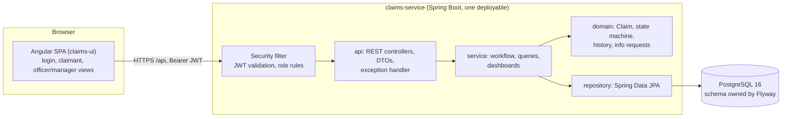
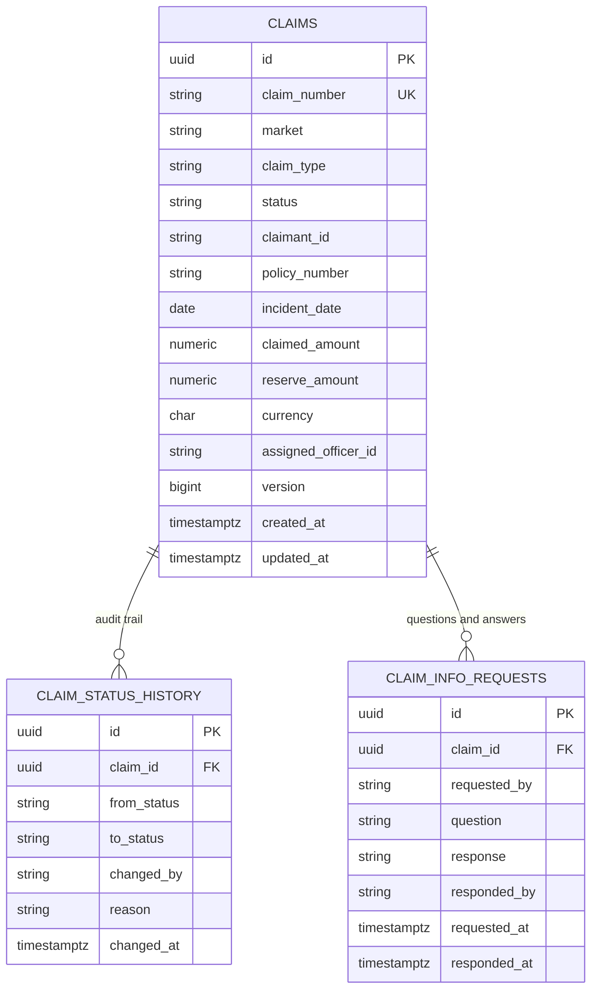
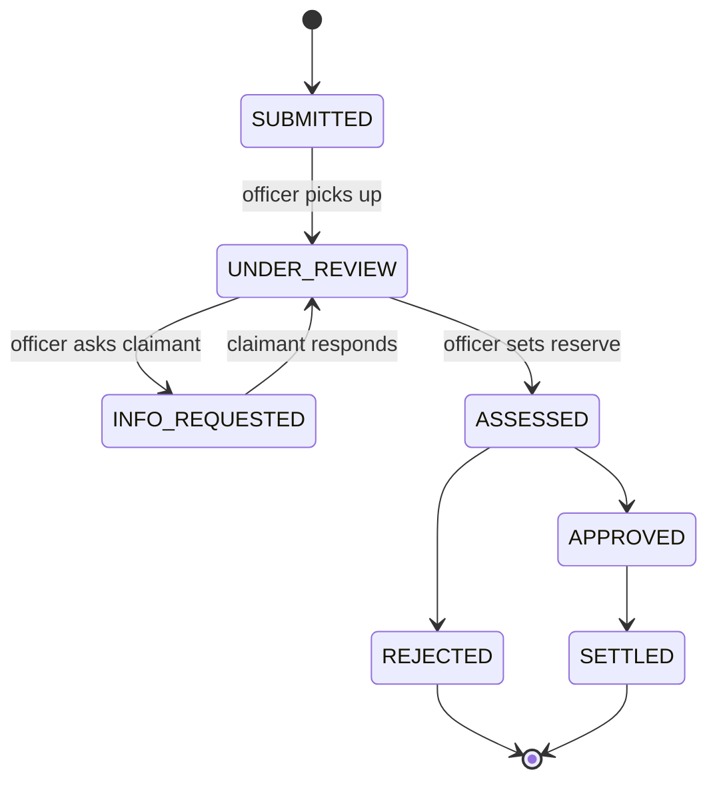
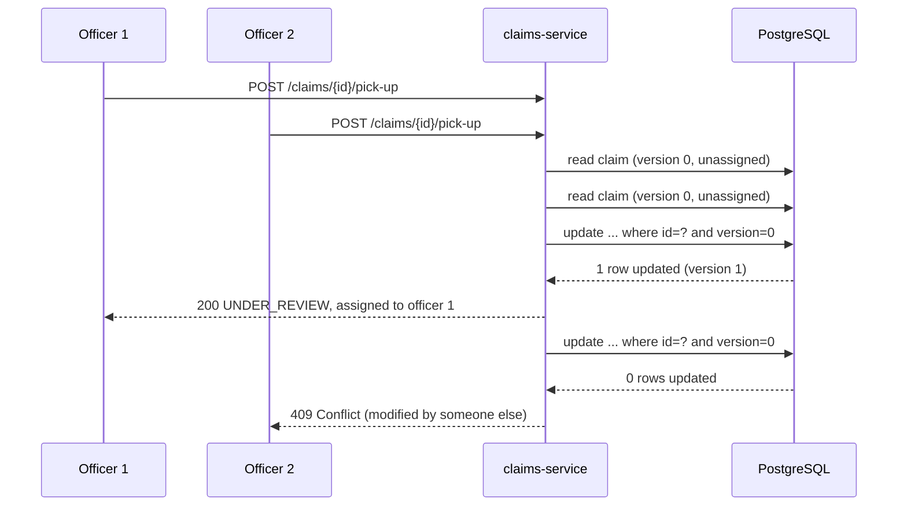

# Architecture

This document describes what was built, why, and where it would go next. It reflects the code in this repository, including its known gaps.

## 1. Scope and priorities

The brief asks for a claims platform serving two user types (claimants and claims staff) from one Angular app. With a 2-3 hour target I prioritised, in order:

1. A correct, defensible backend core: claim lifecycle, audit trail, concurrency safety, role-based security.
2. The two management questions in the brief: **what does an officer need to see to manage workload** and **what is our outstanding liability exposure**.
3. A minimal Angular app that exercises the main flows.

Deliberately left out: document uploads, real notifications, Kafka, an external identity provider, FX conversion, and an automated integration-test suite (see sections 9 and 10).

## 2. System overview

- **One service, one database.** A modular monolith with clear package boundaries (`api`, `service`, `domain`, `repository`, `security`, `config`).
- **Frontend to backend contract** is the REST API, documented by OpenAPI (Swagger UI at `/swagger-ui.html`). Requests and responses are DTOs (Java records), never JPA entities.
- In development the Angular dev server proxies `/api` to Spring Boot, which avoids CORS and keeps the browser on a single origin.

## 3. Domain model

Key modelling choices:

- **Money** is `NUMERIC(14,2)` / `BigDecimal` with an explicit ISO currency, never floating point.
- **Market and currency** are first-class fields because the platform spans six markets.
- **`version`** is the optimistic-locking column (`@Version`).
- **`reserve_amount`** is the insurer's liability estimate, set when a claim is assessed. It differs from `claimed_amount`, which is what the claimant asked for.
- **Schema ownership:** Flyway migrations (`V1__init_claims.sql`, `V2__info_requests.sql`) are the source of truth. Hibernate runs with `ddl-auto=validate`, so entity/schema drift fails at startup instead of silently altering tables.
- **Claimant and officer ids** are plain strings (the JWT subject). There is no user table, so identity is simple (see section 7).

## 4. Claim lifecycle (state machine)

- Allowed transitions live in one place, the `ClaimStatus` enum. Every change goes through `Claim.changeStatus()`, so a controller or service cannot skip a stage.
- An illegal transition raises `InvalidStatusTransitionException`, returned as **409 Conflict**.
- Every transition writes a `claim_status_history` row **in the same transaction** as the change, so the audit trail cannot disagree with the claim.
- `REJECTED` and `SETTLED` are terminal. Rejection is only possible after assessment (a design choice, easy to relax if the business wants earlier rejection).

## 5. Concurrency: two officers, one claim

Pick-up uses **optimistic locking** instead of database row locks. The assumption is that conflicts are rare, and a conflict should fail fast with a clear message instead of making officers wait.

There are two paths to the same safe outcome:

1. **Requests arrive one after another:** the second sees the claim already assigned and gets 409 ("already assigned to officer-1").
2. **Requests truly overlap:** both read version 0, and the loser's update affects zero rows. `OptimisticLockingFailureException` is mapped to 409.

The assigned officer is the only one allowed to assess, request information, approve, reject or settle (others get 403).

## 6. API surface and access rules

| Endpoint | Purpose | Allowed roles |
|---|---|---|
| `POST /api/auth/login` | Exchange credentials for a JWT | public |
| `POST /api/claims` | Report an incident | CLAIMANT |
| `GET /api/claims/mine` | Claimant's own claims | CLAIMANT |
| `GET /api/claims/{id}` | Claim detail (claimants only see their own, otherwise 404) | any authenticated |
| `GET /api/claims` | Queue and search: `status`, `assignedTo`, `unassigned`, `market`, paging, oldest first | OFFICER, MANAGER |
| `POST /api/claims/{id}/pick-up` | Take an unassigned claim | OFFICER |
| `POST /api/claims/{id}/assess` | Set the reserve, move to ASSESSED | OFFICER (assigned) |
| `POST /api/claims/{id}/approve` / `reject` / `settle` | Decide and settle | OFFICER (assigned) |
| `POST /api/claims/{id}/info-requests` | Ask the claimant for more information | OFFICER (assigned) |
| `POST /api/claims/{id}/info-requests/{rid}/response` | Claimant answers | CLAIMANT (owner) |
| `GET /api/claims/{id}/info-requests` | View questions and answers | owner or staff |
| `GET /api/dashboard/workload` | Open claims per officer by status, oldest open claim, unassigned count | OFFICER, MANAGER |
| `GET /api/dashboard/exposure` | Outstanding liability by market and currency | MANAGER |

Conventions:

- **Explicit action endpoints** (`/pick-up`, `/assess`, ...) instead of one generic "set status" call, so each action has its own validation and permission.
- **Errors** use RFC 7807 `ProblemDetail`: 400 with a field-by-field `errors` map for validation, 401 unauthenticated, 403 wrong role or not the assigned officer, 404 not found, 409 illegal transition or conflict.

## 7. Security

- **Stateless JWT (HS256)** issued by `/api/auth/login`, carrying the user id (subject) and a `role` claim: `CLAIMANT`, `OFFICER` or `MANAGER`. Spring Security validates it as an OAuth2 resource server.
- **Two layers of enforcement:** URL rules by role in `SecurityConfig`, plus ownership checks in the service layer. A role check alone cannot answer "whose claim is this?".
- **Identity comes from the token, never the request body**, so a claimant cannot submit on someone else's behalf.
- **Another claimant's claim returns 404, not 403**, so claim ids cannot be probed.
- Angular route guards only improve the UI. They are not a security boundary, because the server enforces every rule.

Known gaps: hardcoded demo users (password `password`), a shared HMAC secret with a development default, no refresh tokens or revocation, and the token is stored in `sessionStorage` in the SPA.

## 8. Workload and exposure: how the numbers are defined

**Open claim** means any status except `REJECTED` and `SETTLED`. `APPROVED` is still open, because the money has not been paid.

**Exposure** for a claim is its `reserve_amount` if it has been assessed, otherwise its `claimed_amount`. The dashboard sums this over open claims, **grouped by market and currency**. Currencies are never added together, because summing SGD and THB is meaningless. A single reporting-currency figure would need an FX-rate source (listed under next steps).

**Workload** shows, per officer, the number of open claims by status and the creation date of their oldest open claim (for ageing), plus the count of unassigned `SUBMITTED` claims. Both dashboards are computed in the database with grouped JPQL queries, not in Java.

## 9. Synchronous vs asynchronous communication

**Today everything is REST.** Submitting, assigning, deciding and querying claims all need an immediate and consistent response, and with one service and one database there is no independent consumer that would benefit from a message broker.

**Why not Kafka now:** it would add a broker, serialisation contracts, consumer handling and failure modes without solving a problem the system has. Kafka becomes worthwhile when:

- notifications, reporting/exposure projections and audit become separate consumers,
- we need replay, or consumers must scale independently,
- claim volume across the six markets needs decoupling from the request path.

**Planned design:** publish domain events (`ClaimSubmitted`, `ClaimAssigned`, `InfoRequested`, `ClaimDecided`) behind a `ClaimEventPublisher` interface. Reliability would come from a **transactional outbox** (write the event to a table in the same transaction as the state change, then relay it to Kafka), so a claim can never be saved without its event or the reverse. Topics would be keyed by claim id to preserve per-claim ordering, and consumers would be idempotent, because Kafka delivery is at-least-once.

This part is **not implemented**. It is documented as the intended direction.

## 10. Frontend structure

One Angular codebase (standalone components, signals) serving both user types:

- `LoginComponent` signs in and routes by role.
- `ClaimantComponent`: submit a claim, list own claims and statuses, answer information requests.
- `OfficerComponent`: unassigned queue, own open claims with actions (pick up, assess, request info, approve, reject, settle), team workload, and, for managers, exposure.
- `AuthService` holds the session, an HTTP interceptor attaches the JWT and returns the user to login on 401, and a role guard protects each route.

Shortcuts: `window.prompt` for small inputs, hand-written TypeScript types instead of a client generated from the OpenAPI spec, no frontend tests, no lazy loading.

## 11. Testing and verification

- **Automated:** unit tests for the state machine (`ClaimStatusTest`): the happy path, skipped stages, terminal states, and the entity rejecting an illegal transition.
- **Manually verified against the running system** (curl and the UI): the full lifecycle with its audit trail, role and ownership rules (401, 403, 404), validation errors, queue filters, the workload and exposure numbers (hand-checked), and concurrent pick-up returning one 200 and one 409.
- **Not yet automated:** Testcontainers integration tests, especially a forced race on concurrent pick-up. This is the first thing I would add.

## 12. Trade-offs and evolution

| Decision | Why | What would change it |
|---|---|---|
| Modular monolith | One team, one DB, short timeline; fewer moving parts | Independent scaling or deployment needs; separate teams |
| PostgreSQL + Flyway | Lightweight in containers, strong SQL, versioned migrations | Existing enterprise standard (e.g. SQL Server) |
| Optimistic locking | Conflicts are rare; fail fast with a clear error | High contention on a hot queue (consider `SKIP LOCKED`) |
| History in the same transaction | Audit trail cannot drift from the claim | Very high volume (consider event sourcing or CDC) |
| Entities hidden behind DTOs | Stable API contract, free to change the schema | n/a |
| Demo user directory | Keeps the focus on authorisation rules | Real deployments use an OIDC identity provider |

**Likely service boundaries if this grows:** notifications, reporting/exposure projection and identity are the natural first splits, because they consume events and do not need to share a transaction with claim state changes.

## 13. Next steps

1. Testcontainers integration tests, including the concurrent pick-up race.
2. Transactional outbox plus Kafka for claim events (notifications, exposure projection, audit).
3. OIDC identity provider with RS256 and JWKS instead of the demo directory and shared secret.
4. Authority limits (a manager must approve above a reserve threshold) and SLA/ageing alerts.
5. Document attachments, a generated TypeScript client from OpenAPI, metrics and tracing.
6. FX-rate source for a single reporting-currency exposure view.
